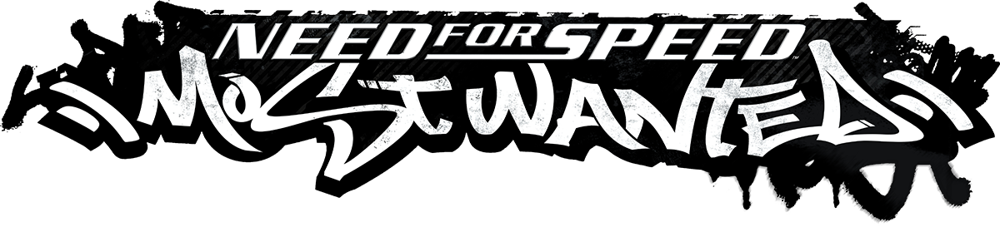

<div align=center>



</div>
<h1 align=center>UFC 3 Undisputed — Nintendo Switch port</h1>

A native Nintendo Switch port of the Xbox 360 version of **UFC 3 Undisputed** (2012), by static recompilation with
[ReXGlue](https://github.com/rexglue/rexglue-sdk).

> [!IMPORTANT]
> **The Switch build is not verified yet.** The PC build reaches menus and training. CAF skin and shorts can be
> regenerated with source fixes for colored hair and missing albedo regions. On 2026-10-18, the repaired CAF was
> checked in D3D12 training: colored hair and the intermittent black triangles no longer appeared. Nothing has been tested on a Switch;
> the NRO has never been built because the required Mesa SDK is not here. See
> [Where the port is](#where-the-port-is) for exactly what was verified and what was not.

It is not an emulator. The PowerPC code of the game's `default.xex` is translated to C++, which is compiled for the
Switch, and the game is meant to be drawn by a native Vulkan renderer running on NVK (Mesa) — that renderer is the
previous game's work and is parked for now, because it hooks addresses this game does not have.

> [!NOTE]
> You need your own copy of the Xbox 360 game: a disc image (`.iso`) or the extracted disc with its `default.xex`.

## Where the port is

This repository is a hard fork of [nfsmw-nx](https://github.com/StevensND/nfsmw-nx) (a finished port of *Need for
Speed: Most Wanted*) being turned into a port of UFC 3 Undisputed. The reusable machinery — the Horizon layer in `sdk/`,
the Mesa/NVK patch, the shader tooling, the build scripts — is that port's work and is sound. Everything that names an
address, a hook, a function or a measured number is still *Need for Speed: Most Wanted's* and is wrong here.

Verified, on this machine, with the retail ISO:

| Step | State |
|---|---|
| Extract the disc (`tools/fase1_extraer.py`) | Works. Title ID `5451087D`, Media ID `3E0E52AB`, image `0x82000000`–`0x8363F400`, entry point `0x823C7E68`. |
| Build the code generator (`sdk/` → `rexglue.exe`) | Works (ReXGlue v0.10.0, clang 23.1.3). |
| Translate the game to C++ (`rexglue codegen`) | Works: **65,886 functions**, 281 files, 293 MB of C++, in about 4 minutes. |
| Build the PC executable | Works: `ufc3-undisputed-nx.exe`, 97 MB, plus `rexruntime.dll` and `rexgpu-xenos.dll`. |
| Run it on PC | Reaches menus and training. Source fixes for colored hair and incomplete CAF albedo were checked in training on 2026-10-18 without eager readback; the user no longer reproduced black triangles after regenerating CAF 1. The command-synchronization regression was fixed in C++; training measured 59.97–60.04 FPS, including regeneration with heavy collectors disabled. |
| Build the NRO for the Switch | **Not run.** Needs a built Mesa SDK; see [docs/building.md](docs/building.md). |

The initial PC run mounted the disc, mapped the guest memory arena, initialized the function table for
`code=82220000-8325CDB0`, registered the 65,886 recompiled functions and then stopped with

```
[FATAL] Call to invalid or unregistered function at guest address 0x831820A8
```

That address is inside this game's code but was not a function start the analysis recognised: it is a 32-byte function
in a gap between two functions, reached through a pointer stored in the image. `app/huecos.toml` (generated by
`tools/huecos_punteros.py` from this game's own image) declares 2,757 such addresses at once.

Everything else in this repository is the inherited port and **does not describe UFC 3 Undisputed yet**: the native
renderer, the audio rescue, the cutscene path, the settings menu, the debug menu, the resolution handling and the
performance numbers all belong to the previous game. Their code was parked in `app/src/aparcado/` (see its README) and
their documentation has not been rewritten.

## How to build and run it on a PC

Needs clang, CMake, Ninja and Python on `PATH`, and your own ISO.

```sh
# 1. Third-party sources of the SDK. Once.
python tools/fetch_thirdparty.py

# 2. Extract the disc.
python tools/fase1_extraer.py "path/to/UFC Undisputed 3.iso" -o assets/game_root

# 3. Build the code generator. The binary lands in sdk/out/win-amd64/, not in out/host.
cmake -S sdk -B out/host -G Ninja -DCMAKE_BUILD_TYPE=Release \
  -DCMAKE_C_COMPILER=clang -DCMAKE_CXX_COMPILER=clang++
cmake --build out/host --target rexglue -j 12

# 4. Translate the game to C++ (from app/, or through tools/codegen.sh).
cd app && ../sdk/out/win-amd64/rexglue.exe codegen ufc3_undisputed_nx_manifest.toml

# 5. Build and run on PC.
cmake -S app -B app/out/build/win-amd64-release -G Ninja -DCMAKE_BUILD_TYPE=Release \
  -DCMAKE_C_COMPILER=clang -DCMAKE_CXX_COMPILER=clang++ -DREXGLUE_USE_VULKAN=ON \
  -DREXSDK_DIR="$PWD/sdk"
cmake --build app/out/build/win-amd64-release --target ufc3-undisputed-nx -j 12
```

Put `ufc3-undisputed-nx.exe`, `rexruntime.dll` and `rexgpu-xenos.dll` in a folder with `game_root/` beside them (or the
`.iso`, which it finds by itself) and run the `.exe`. Its log is written to `logs/` in that folder.

The PC D3D12 backend at 1x resolution supplies GPU-written data when the guest CPU reads it; eager resolve and
memexport readback are disabled in the configuration. Adjacent resources stay separate by GPU-write generation.
Source fixes restore unsigned 16-bit integer texture samples used by CAF compression and preserve clipped resolve
tails during atlas composition. Back up damaged saves before regenerating them in the CAF editor; settings alone
cannot repair saved pixels. See [CAF texture recovery](docs/building.md#caf-texture-recovery), including the
reproducible checks and `tools/comprobar_texturas_caf.py --all-mips --mip-bands`.

The Switch build is in [docs/building.md](docs/building.md).

## How it works

- **The game's code is translated, not emulated.** [ReXGlue](https://github.com/rexglue/rexglue-sdk) translates every
  function of the game's program (`default.xex`) to C++, which is compiled for the Switch. ReXGlue also gives the game
  what it expects from an Xbox 360: its system, files, audio and controllers. This port is to add the Switch part:
  memory, threads, crash handling, clocks, audio output and showing the frames on screen.
- **Everything else is still to do.** See [docs/porting-another-game.md](docs/porting-another-game.md) for what the
  previous port did and in which order, and [docs/README.md](docs/README.md) to find your way around it.

## Documentation

**Read [AGENTS.md](AGENTS.md) first if you are going to change anything**: it says what may be treated as true in this
repository and what may not.

The documents in [docs/](docs/) were written for *Need for Speed: Most Wanted*. `docs/README.md` says so at the top. They
are worth reading for the machinery — the Horizon layer, the shader tooling, the toolchain traps — and for the order of
the work, but not for any address, hook, offset or measured number.

## Credits

- **Electronic Arts and THQ** — publisher and developer of UFC 3 Undisputed. This is an unofficial, fan-made port with
  no affiliation.
- **[madelrandel-blip](https://github.com/madelrandel-blip/UFC3_UNDISPUTED_NX-Recompiled)** — UFC3_UNDISPUTED_NX
  Recompiled, the recompilation project this port started from.
- **[StevensND](https://github.com/StevensND)** — [nfsmw-nx](https://github.com/StevensND/nfsmw-nx), the finished port
  this repository is a fork of. The Horizon layer, the native renderer, the shader tooling and the build scripts are its
  work.
- **[Tom Clay](https://github.com/rexglue/rexglue-sdk)** — the ReXGlue SDK, built on the work of the
  **[Xenia](https://xenia.jp)** team.
- **[hedge-dev](https://github.com/hedge-dev/XenosRecomp)** — XenosRecomp, the Xenos shader translator.
- **[danfromtico](https://github.com/danfromtico/mesa-switch)** and **[NaGaa95](https://github.com/NaGaa95/mesa-switch)** — mesa-switch: Mesa, NVK and NAK on Horizon.
- **[devkitPro](https://devkitpro.org) and [switchbrew](https://github.com/switchbrew/libnx)** — devkitA64 and libnx.
- The other libraries listed in [THIRD_PARTY_NOTICES.md](THIRD_PARTY_NOTICES.md).

## Legal

No affiliation with Electronic Arts or THQ. "UFC" and "UFC Undisputed" are trademarks of their respective owners. This
repository contains no assets or program code from the original game. Users must provide their own legally obtained
copy. Running homebrew requires custom firmware, which violates Nintendo's ToS and can get a console banned — your call.

Source code is provided under the GPL-3.0 License (see [LICENSE](LICENSE)), inherited from nfsmw-nx. The SDK changes are
under the SDK's BSD-3-Clause license and the shader translator and Mesa changes under MIT, so other ports can reuse them
(see [THIRD_PARTY_NOTICES.md](THIRD_PARTY_NOTICES.md)).
